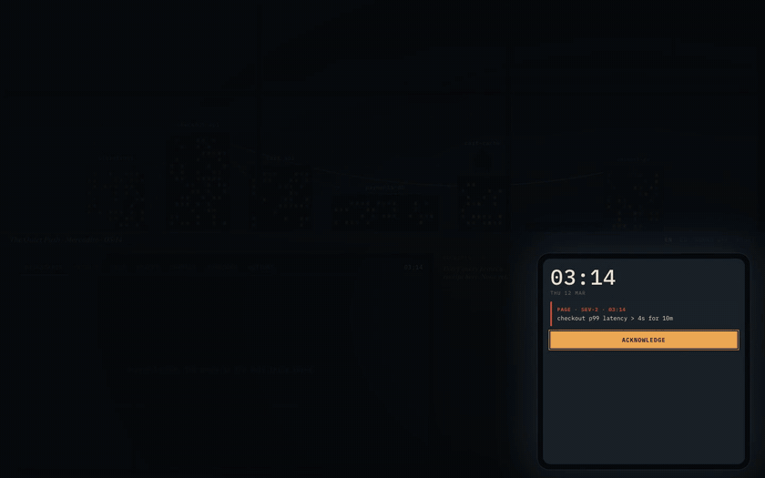

# 3 AM

An interactive course on incident response, played as night-shift cases. A page wakes you at 03:14. You investigate with simulated but realistic telemetry, tape evidence to the window and string it to hypotheses, mitigate while the clock runs and affected users climb, then write a blameless postmortem and see what was really going on.



[Full recording (MP4)](docs/media/case-01-demo.mp4) · screenshots in [English](docs/media/step1/en) and [Spanish](docs/media/step1/es-MX)

It teaches observability, hypothesis-driven debugging, mitigation, incident communication and postmortems as one discipline. It runs standalone and is designed to embed in [Dojo](https://github.com/rodacato/dojo).

## How a case works

- **The window** is the evidence board. The skyline is the service map: each building is a component, its lit windows turn red when its requests fail or crawl, and the cables between rooftops are calls. Torn-off slips and hypothesis cards are taped to the glass, tied with red string. A hypothesis accuses a building; when it holds the strings pull taut, when it has an alibi they come loose and fall.
- **The monitor** holds the tools: dashboards, PromQL, logs, traces, the change log, runbooks and mitigation actions. Every query costs minutes and prints a receipt; the clock moves only when you act.
- **The phone** wakes you, keeps the time and the count of affected users, and carries the stakeholder asking for a status update.
- **After the fix**, a postmortem with a deterministic rubric (no blame, contributing factors not a culprit), then a debrief: the hidden causal chain next to your own night, with detours, time to stable and users affected.

Case 01, *The Quiet Push*, ships in English and Spanish. Cases 02 to 08 are planned.

## Run it

```bash
npm install
```

```bash
npm run dev
```

Then open http://localhost:5317. Node 22 or newer.

| Script | What it does |
| --- | --- |
| `npm run build` | Typecheck and build to `dist/` with relative paths (GitHub Pages and iframes) |
| `npm test` | Vitest: determinism, signal agreement, mitigations, PromQL, machine, OTLP, worker boundary, solvability |
| `npm run e2e` | Playwright: the full case in both locales against the production build |
| `npm run check:i18n` | Fails on any key missing in any locale or referenced by case data |
| `npm run check:solvable` | A scripted investigator must close every case within budget, for five seeds |
| `npm run check` | All of the above except e2e |

CI runs every check and the e2e suite; pushes to `main` deploy to GitHub Pages.

## How it is built

Everything runs in the browser; there is no backend. A case is a data file ([case 01](src/content/cases/case-01/case.ts)): topology, traffic, config, changes, fault effects, red herrings, log templates, tools and their time costs, mitigations, stakeholder prompts, contributing factors and the causal chain. Adding a case is adding a folder.

- `src/engine`: case schema (Zod), seeded randomness, system state per minute, tools, the XState incident lifecycle, rubric, scoring, solvability. Pure TypeScript, no browser APIs.
- `src/telemetry`: one request simulator that metrics, logs and traces all derive from, so the signals agree by construction. OpenTelemetry-shaped, generated on demand, never stored.
- `src/query`: a [PromQL subset and the log and trace filters](docs/query-languages.md), with honest errors for anything outside them.
- `src/worker`: the same engine behind a Web Worker with an LRU cache.
- `src/i18n`, `src/content`, `src/host`, `src/ui`: locales, cases and sources, the host bridge, the desk.

Decisions and their reasons are in [docs/adr](docs/adr/README.md). The visual directions explored before building are in [design/step0](design/step0).

## Take the case home

The debrief can export the night as three OTLP/JSON files: traces (every slow or failed request plus a sample of healthy ones), logs linked to their traces, and metrics. To browse the traces in Jaeger, run Jaeger and an OpenTelemetry Collector (contrib) that reads the files:

```yaml
# collector.yaml
receivers:
  otlpjsonfile:
    include: [/take-home/*.otlp.json]
    start_at: beginning
exporters:
  otlp/jaeger:
    endpoint: jaeger:4317
    tls: { insecure: true }
  debug: {}
service:
  pipelines:
    traces: { receivers: [otlpjsonfile], exporters: [otlp/jaeger] }
    logs: { receivers: [otlpjsonfile], exporters: [debug] }
    metrics: { receivers: [otlpjsonfile], exporters: [debug] }
```

Point the logs pipeline at Loki or the traces at Tempo the same way. The telemetry keeps its original timestamps (the night of 2026-03-12), so search that date range; metric backends that refuse old samples need backfill enabled.

## Sources

The course paraphrases and cites; it does not reproduce. Google's SRE book and workbook (incident management, postmortem culture), Brendan Gregg's USE method, Tom Wilkie's RED method, *Observability Engineering* (Majors, Fong-Jones, Miranda), Sidney Dekker's *Field Guide to Understanding Human Error* and Richard Cook's *How Complex Systems Fail*. Each case ends with what to read next.

## License

[MIT](LICENSE)
