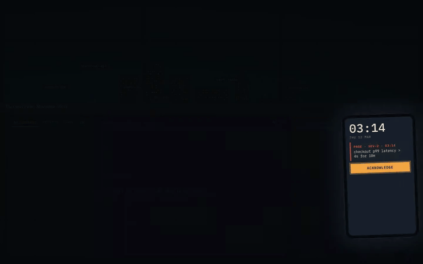

# 3 AM

[](https://github.com/rodacato/3am/actions/workflows/ci.yml)
[](https://github.com/rodacato/3am/actions/workflows/site-pages.yml)
[](LICENSE)

**Play it in your browser: [rodacato.github.io/3am](https://rodacato.github.io/3am/)**

An interactive course on incident response, played as night-shift cases. A page wakes you at 03:14. You investigate with simulated but realistic telemetry, tape evidence to the window and string it to hypotheses, mitigate while the clock runs and affected users climb, then write a blameless postmortem and see what was really going on.



[Full recording (MP4)](docs/media/demo.mp4) · screenshots in [English](docs/media/step1/en) and [Spanish](docs/media/step1/es-MX)

It teaches observability, hypothesis-driven debugging, mitigation, incident communication and postmortems as one discipline. It runs standalone and is designed to embed in [Dojo](https://github.com/rodacato/dojo).

**Who it is for:** developers who want practice debugging and troubleshooting a running system: you know HTTP and services, and you have not yet worked an incident from page to postmortem. It needs a desktop screen, 900 px or wider. One case ships today, in English and Spanish.

## How a case works

- **The window** is the evidence board. The skyline is the service map: each building is a component, its lit windows turn red when its requests fail or crawl, and the cables between rooftops are calls. Torn-off slips and hypothesis cards are taped to the glass, tied with red string. A hypothesis accuses a building; when it holds the strings pull taut, when it has an alibi they come loose and fall.
- **The monitor** holds the tools: dashboards, PromQL, logs, traces, the change log, runbooks and mitigation actions. Every query costs minutes and prints a receipt; the clock moves only when you act.
- **The phone** wakes you, keeps the time and the count of affected users, and carries the stakeholder asking for a status update.
- **After the fix**, a postmortem with a deterministic rubric that checks its shape (timestamps, numbers, factors, no blame words) and leaves truth and clarity to you, then a debrief: the hidden causal chain next to your own night, with minutes spent off the case evidence, time to stable and estimated users affected.

Case 01, *The Quiet Push*, ships in English and Spanish. Cases 02 to 08 are planned.

## Run it

Needs Node 22 or newer and npm.

```bash
npm install
npm run dev        # http://localhost:5317
```

A seven-step walkthrough of the desk opens on the first visit and comes back from the TOUR button under the window. Add `?tour=off` to the URL to never show it (embeds, recordings, tests) or `?tour=on` to show it again.

## Checks

| Script | What it does |
| --- | --- |
| `npm run check` | typecheck, lint, Vitest, `check:i18n` and `check:solvable`: what CI's Check job runs |
| `npm test` | Vitest: determinism, signal agreement, mitigations, PromQL, machine, OTLP, worker boundary, solvability |
| `npm run check:i18n` | Fails on any key missing in any locale or referenced by case data |
| `npm run check:solvable` | A scripted investigator must close every case within budget, for five seeds |
| `npm run e2e:smoke` | Builds, then the one `@smoke` Playwright test (progress survives a reload) |
| `npm run e2e` | Builds, then every Playwright test: case 01 from page to debrief in both locales, worker vs Node log counts, reduced motion |
| `npm run build` | Typecheck and build to `dist/` with relative paths (GitHub Pages and iframes) |
| `npm run demo` | Rebuilds and records `docs/media/demo.mp4` and `demo.gif` (needs `ffmpeg`) |

Install the browser once before the first e2e run: `npx playwright install chromium`.

CI runs `check` and the smoke test on every push and pull request, and the full e2e suite nightly and on demand. Pushes to `main` deploy to GitHub Pages.

## Architecture

Everything runs in the browser; there is no backend. The simulation is deterministic: the same case, seed and actions produce the same night. ESLint forbids `Math.random`, `Date.now` and browser globals in `src/engine`, `src/telemetry` and `src/query`. A case is a data file ([case 01](src/content/cases/case-01/case.ts)): topology, traffic, config, changes, fault effects, red herrings, log templates, tools and their time costs, mitigations, stakeholder prompts, contributing factors and the causal chain. Adding a case is adding a folder.

- `src/engine`: case schema (Zod), seeded randomness, system state per minute, tools, the XState incident lifecycle, rubric, scoring, solvability. Pure TypeScript, no browser APIs.
- `src/telemetry`: one request simulator that metrics, logs and traces all derive from, so the signals agree by construction. OpenTelemetry-shaped, generated on demand, never stored.
- `src/query`: a [PromQL subset and the log and trace filters](docs/query-languages.md), with honest errors for anything outside them.
- `src/worker`: the same engine behind a Web Worker with an LRU cache.
- `src/i18n`, `src/content`, `src/host`, `src/ui`: locales, cases and sources, the host bridge, the desk.

All visible text lives in `src/i18n/locales/` and in each case's `locales/`; `check:i18n` fails on a missing key. Decisions and their reasons are in [docs/adr](docs/adr/README.md). The visual directions explored before building are in [design/step0](design/step0).

## Embedding in Dojo

[Dojo](https://github.com/rodacato/dojo) is a self-hosted practice space for developers that embeds courses like this one in an iframe. 3 AM talks to its host only through the `HostBridge` port ([src/host/bridge.ts](src/host/bridge.ts)), and only the standalone adapter exists today. The embedded adapter will speak Dojo's scroll protocol v0 ([ADR 0012](docs/adr/0012-dojo-integration.md); the manifest and message mapping are in [docs/plan.md](docs/plan.md)). Until Dojo offers a review capability, the deterministic rubric is the postmortem review ([ADR 0011](docs/adr/0011-contributing-factors-and-review.md)).

## Contributing

A case is one folder in `src/content/cases/<id>/`: `case.ts`, validated by `src/engine/case-schema.ts`, plus one locale file per language in its `locales/`. `check:i18n` fails on any key the case uses that a locale lacks, and `check:solvable` fails unless the case's solution closes it within budget for every seed. A language is one more file in `src/i18n/locales/` and in every case's `locales/`. Run `npm run check` and `npm run e2e:smoke` before opening a pull request, and write an ADR when a decision changes.

## Take the case home

The debrief can export the night as three OTLP/JSON files: traces (every slow or failed request plus a sample of healthy ones), logs linked to their traces, and metrics. To browse the traces in Jaeger, run Jaeger and an OpenTelemetry Collector (contrib) that reads the files:

```yaml
# collector.yaml
receivers:
  otlpjsonfile:
    include: [/take-home/*.otlp.json]
    start_at: beginning
exporters:
  otlp/jaeger:
    endpoint: jaeger:4317
    tls: { insecure: true }
  debug: {}
service:
  pipelines:
    traces: { receivers: [otlpjsonfile], exporters: [otlp/jaeger] }
    logs: { receivers: [otlpjsonfile], exporters: [debug] }
    metrics: { receivers: [otlpjsonfile], exporters: [debug] }
```

Point the logs pipeline at Loki or the traces at Tempo the same way. The telemetry keeps its original timestamps (the night of 2026-03-12), so search that date range; metric backends that refuse old samples need backfill enabled.

## Sources

The course paraphrases and cites; it does not reproduce. Google's SRE book and workbook (incident management, postmortem culture), Brendan Gregg's USE method, Tom Wilkie's RED method, *Observability Engineering* (Majors, Fong-Jones, Miranda), Sidney Dekker's *Field Guide to Understanding Human Error* and Richard Cook's *How Complex Systems Fail*. Each case ends with what to read next. Fonts: Fraunces and IBM Plex Mono, self-hosted through Fontsource.

## License

MIT, see [LICENSE](LICENSE). Dependencies keep their own licenses: elkjs (EPL-2.0 or GPL-3.0, used unmodified), @prometheus-io/lezer-promql (Apache-2.0) and the fonts (SIL OFL 1.1). See [ADR 0009](docs/adr/0009-libraries.md).
